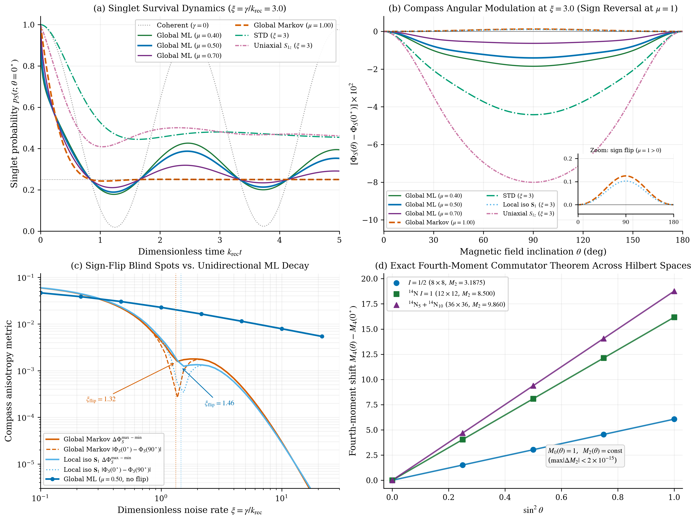
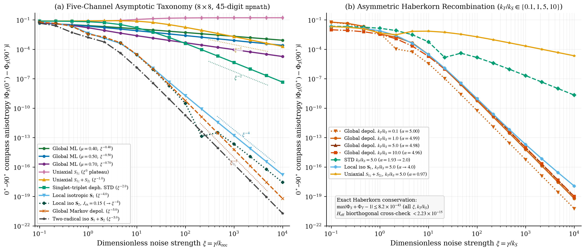
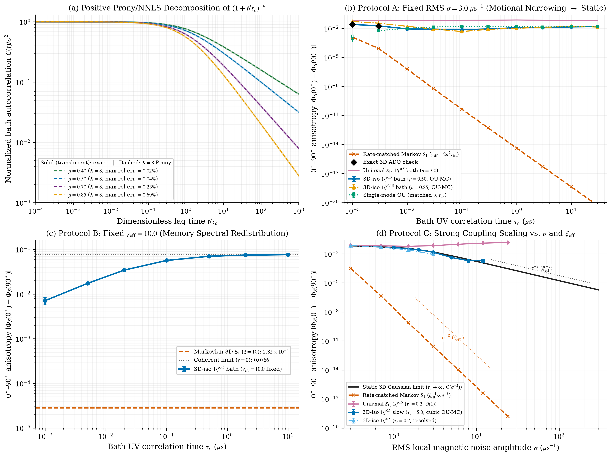
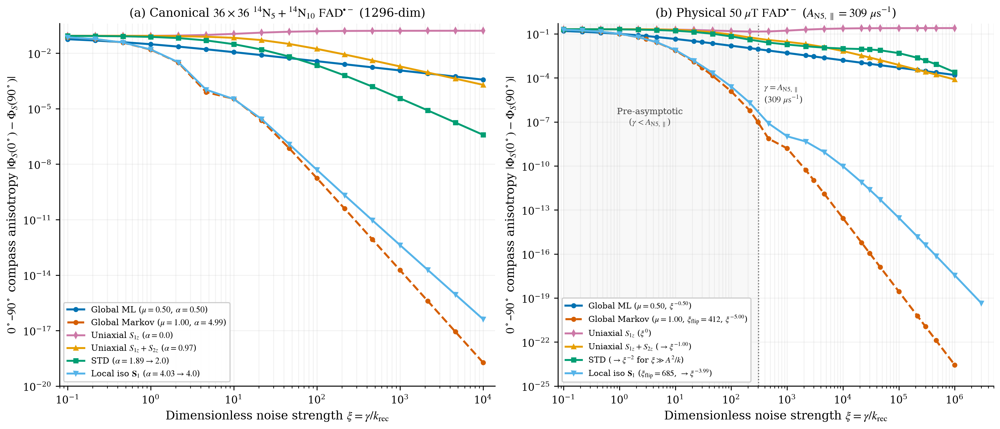

# Fourth-Moment Commutator Protection, Five-Channel Liouvillian Scaling, and Non-Commuting Colored-Bath Dynamics in Radical-Pair Magnetoreception

[](https://github.com/Mehardeep-Singh-GG/radical-pair-commutator-protection/actions/workflows/verify.yml)
[-blueviolet.svg)](lean_proofs/DiamondProofs/Paper1_RadicalPair.lean)
[](lean_proofs/axioms_check.txt)
[](requirements.txt)
[](LICENSE)
[](manuscript/paper1_radical_pair.pdf)

Official research repository containing the **pure Lean 4.16.0 formal proofs**, **45-digit arbitrary-precision Liouvillian solvers**, **Prony Auxiliary Density Operator (ADO) and exact integrated-OU Monte Carlo simulations**, **strict RFC-8259 datasets**, **vector figures**, and **journal-agnostic LaTeX manuscript & Supplemental Material** for:

> **Mehardeep Singh**, *"Fourth-Moment Commutator Protection, Five-Channel Liouvillian Scaling, and Non-Commuting Colored-Bath Dynamics in Radical-Pair Magnetoreception"*, Sri Chaitanya Educational Institutions.

---

## Executive Summary & Key Quantitative Results

This study proves exact structural theorems governing strong-noise magnetosensitivity in multi-nucleus radical-pair spin systems and resolves the sharp physical dichotomy between phenomenological commuting memory kernels and microscopic non-commuting local colored baths:

| Mechanism / Result | Exact Theoretical Law | Numerical / Formal Verification |
|---|---|---|
| **Commutator Protection (Thm. 1)** | $[H_Z, P_S] = [H_{\mathrm{ex}}, P_S] = [H_{\mathrm{dip}}, P_S] = 0 \implies M_0 = 1,\; M_2(\hat{\mathbf{b}}) = \text{const}$ | Proved in Lean 4 for arbitrary $K$-nucleus spin graphs ($e_k \in \{1,2\}$, symmetric $\mathbf{D}^\top = \mathbf{D}$) |
| **Exact Fourth-Moment Anisotropy (Thm. 2)** | $\Delta M_4(\hat{\mathbf{b}}) = \omega_L^2 \sum_{k=1}^K \frac{I_k(I_k+1)}{6} \big(\hat{\mathbf{n}}_0^\top \mathbf{A}_k\mathbf{A}_k^\top\hat{\mathbf{n}}_0 - \hat{\mathbf{b}}^\top \mathbf{A}_k\mathbf{A}_k^\top\hat{\mathbf{b}}\big)$ | Invariant under $J_{\mathrm{ex}}$ and $\mathbf{D}$; verified across 7 architectures ($8\times 8$, $12\times 12$, $36\times 36$ $50\,\mu\text{T}$ $\mathrm{FAD}^{\bullet-}\text{--}\mathrm{Z}^{\bullet}$) to rel. err $4.39\times 10^{-16}\text{--}8.24\times 10^{-14}$ |
| **Global Markovian Envelope & Blind Spot (Thm. 3)** | $\Delta\Phi_S^{(1)}(\theta) = \Theta(\xi^{-5})$ with sign-flip blind spot where $\Delta\Phi_S^{(1)}(\theta_{\mathrm{blind}}) = 0$ | Analytic & Lean 4 verified; $36\times 36$ $50\,\mu\text{T}$ $\mathrm{FAD}^{\bullet-}$ + $35^\circ$ point-dipole ($r = 1.870\,\text{nm}$, $D_{\mathrm{ZFS}} = -75\,\text{rad}\,\mu\text{s}^{-1}$) preserves $\alpha = 4.9986$ on $[10^4, 10^6]$ |
| **Five-Channel Liouvillian Taxonomy (Sec. IV)** | $\alpha \in \{5, 2, 4, 1, 0\}$ controlled by $\mathcal{M}_{\mathrm{dark}} = \ker(\mathcal{D})$ | Native 45-digit split-operator Haberkorn trace conservation $\max|\Phi_S + \Phi_T - 1| \le 8.21\times 10^{-43}$; STD dark-triplet iterate $+4.51208\,\xi^{-2}$ (0.13% match); local iso $\mathbf{S}_1$ 4-step Schur cascade $-0.163885\,\xi^{-4}$ (0.13% match) |
| **Microscopic Non-Commuting Colored Baths (Sec. V)** | Local $1/f^{0.5}$ vs. rate-matched OU1 & Markovian $\mathcal{D}_{\mathrm{iso},1}$ | $K=8$ Prony ADO matches OU--MC to $< 3\times 10^{-4}$ ($8\times 8$); $36\times 36$ $50\,\mu\text{T}$ exact integrated-OU ($\Delta t = 0.001\,\mu\text{s}$, $T_{\max} = 12\,\mu\text{s}$) shows $+0.1946(14)\to +0.2074(11)$ quasistatic freezing vs. Markovian collapse to $-1.16\times 10^{-13}$ |

---

## Publication Figures

<p align="center">
  
  <br/>
  <em><b>Figure 1.</b> Strong-noise $\xi^{-5}$ commutator protection, sign-flip blind spot, Mittag–Leffler separation, and exact $\sin^2\theta$ linearity of $M_4(\theta) - M_4(0)$.</em>
</p>

<p align="center">
  
  <br/>
  <em><b>Figure 2.</b> Five-channel Markovian scaling taxonomy ($\alpha \in \{5,2,4,1,0\}$) and native 45-digit asymmetric Haberkorn trace conservation ($\le 8.21 \times 10^{-43}$).</em>
</p>

<p align="center">
  
  <br/>
  <em><b>Figure 3.</b> Microscopic non-commuting $1/f^{0.5}$ colored-bath crucible: Prony ADO vs. OU–MC and matched single-mode OU1 across Protocols A, B, and C.</em>
</p>

<p align="center">
  
  <br/>
  <em><b>Figure 4.</b> Physical $36\times 36$ $50\,\mu\text{T}$ $^{14}\text{N}_5 + {}^{14}\text{N}_{10}$ $\mathrm{FAD}^{\bullet-}\text{--}\mathrm{Z}^{\bullet}$ dynamics with $35^\circ$-tilted point-dipole interaction and exact integrated-OU colored baths.</em>
</p>

---

## Repository Structure

```text
radical-pair-commutator-protection/
├── .github/workflows/verify.yml       # Continuous Integration (Lean 4.16.0 + strict data/syntax audit)
├── CITATION.cff                       # Machine-readable citation metadata
├── .zenodo.json                       # Zenodo archival metadata
├── LICENSE                            # MIT License
├── requirements.txt                   # Scientific Python dependencies
├── lean_proofs/
│   ├── lean-toolchain                 # leanprover/lean4:v4.16.0
│   ├── lakefile.toml                  # Standalone Lean 4 package config (zero external dependencies)
│   ├── axioms_check.txt               # Full Lean 4.16.0 kernel axiom audit
│   └── DiamondProofs/
│       └── Paper1_RadicalPair.lean    # 5,991 lines, pure Init, 364 authored public theorems
├── src/
│   ├── prony_ado_lib.py               # Positive Prony NNLS decomposition & Tanimura–Kubo ADO solver
│   ├── verify_01_hamiltonians_and_moments.py   # Theorems 1 & 2 + Laplace-vs-quadrature (7 architectures)
│   ├── verify_02_five_channel_liouville.py     # Native 45-digit split-operator five-channel sweeps
│   ├── verify_03_microscopic_ado_and_mc.py     # Canonical 8x8 Prony ADO + OU–MC + matched OU1
│   ├── verify_04_curves_and_tables.py          # Angular profiles & time-series tables
│   ├── verify_05_supplement_checks.py          # 50-digit checks, ADO depth convergence, static quadrature
│   ├── verify_06_fad50uT_colored_and_dipolar.py # 36x36 50 uT point-dipole & exact integrated-OU MC
│   └── generate_figures.py                     # Vector PDF + PNG publication figure generator
├── data/                              # 8 verified strict RFC-8259 JSON & CSV datasets
├── figures/                           # Figures 1–4 (vector PDF + high-DPI PNG)
├── manuscript/
│   ├── paper1_radical_pair.tex/.pdf   # Main manuscript (journal-agnostic preprint; 15 pages)
│   └── supplement_paper1.tex/.pdf     # Supplemental Material (complete proofs & tables; 13 pages)
└── scripts/
    └── ci_audit.py                    # End-to-end Lean + RFC-8259 JSON + Python verifier
```

---

## Pure Lean 4.16.0 Formal Verification

The formalization in [`lean_proofs/DiamondProofs/Paper1_RadicalPair.lean`](lean_proofs/DiamondProofs/Paper1_RadicalPair.lean) is **100% self-contained on Lean 4.16.0 `Init`** — zero Mathlib imports, zero `sorry`/`admit`, zero custom axioms, and zero `native_decide`/`Lean.ofReduceBool`:

- **Size & Scope:** 5,991 lines | **364** explicitly authored public theorems (**501** authored total including 137 private helpers) | **560** public kernel `thmInfo` declarations | **69** headline main-section theorems across four verified blocks (`UnifiedRP` [28], `SymDip4` [3], `MultiRP` [23], `StrongNoiseAsymptotics4C` [15]).
- **Axiom Purity:** Audited via `Lean.collectAxioms` in [`lean_proofs/axioms_check.txt`](lean_proofs/axioms_check.txt) — `DISALLOWED_AXIOMS = 0` (strictly subsets of Lean's foundational `propext`, `Quot.sound`, `Classical.choice`).

### Quick Verification
```bash
# Install Lean 4.16.0 via elan if not already installed:
# curl https://raw.githubusercontent.com/leanprover/elan/master/elan-init.sh -sSf | sh

cd lean_proofs
lake build DiamondProofs.Paper1_RadicalPair
```

Or run the full automated verification suite (Lean static soundness scan + `lake build` + axiom verification + strict RFC-8259 JSON & Python checks):
```bash
python3 scripts/ci_audit.py
```

---

## Reproducing All Numerical Datasets, Figures, and PDFs

```bash
# 1. Install Python dependencies
pip install -r requirements.txt

# 2. Reproduce all numerical verification datasets in data/
python3 src/verify_01_hamiltonians_and_moments.py
python3 src/verify_02_five_channel_liouville.py
python3 src/verify_03_microscopic_ado_and_mc.py
python3 src/verify_04_curves_and_tables.py
python3 src/verify_05_supplement_checks.py
python3 src/verify_06_fad50uT_colored_and_dipolar.py   # ~7 min (36x36 integrated-OU MC)

# 3. Regenerate all 4 vector figures in figures/
python3 src/generate_figures.py

# 4. Compile manuscript & Supplemental Material (zero warnings/overfulls)
cd manuscript
tectonic paper1_radical_pair.tex
tectonic supplement_paper1.tex
```

---

## Citation

If you use this code, dataset, or Lean 4 formalization, please cite the accompanying manuscript (see also [`CITATION.cff`](CITATION.cff)):

```bibtex
@misc{Singh2026RadicalPair,
  author  = {Singh, Mehardeep},
  title   = {Fourth-Moment Commutator Protection, Five-Channel Liouvillian Scaling,
             and Non-Commuting Colored-Bath Dynamics in Radical-Pair Magnetoreception},
  year    = {2026},
  note    = {Manuscript, numerical dataset, and pure Lean 4.16.0 formalization},
  url     = {https://github.com/Mehardeep-Singh-GG/radical-pair-commutator-protection}
}
```

## License

This project is released under the [MIT License](LICENSE).
